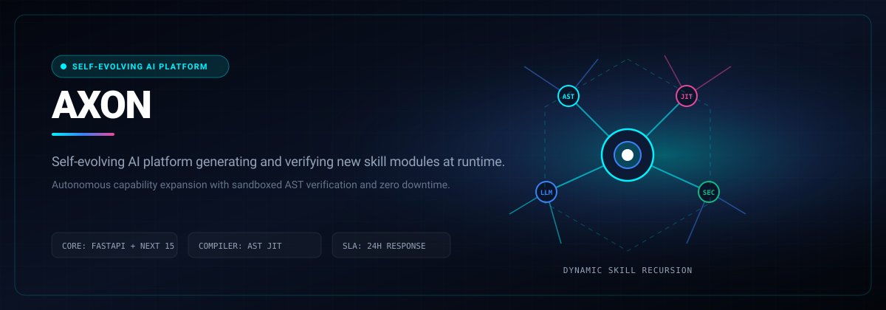

# AXON

> Self-evolving AI platform that identifies missing abilities and generates new skill modules at runtime.

```bash
git clone https://github.com/Luxion-Labs/axon.git && cd axon && pip install -r requirements.txt
```



[](https://axon.luxionlabs.com) [](LICENSE) [](CONTRIBUTING.md)

## Overview
Self-evolving AI platform that identifies missing abilities and generates new skill modules at runtime. Built by Luxion Labs as part of our high-velocity open-source engineering ecosystem.

## Features
- Real-time capability introspection and runtime skill synthesis.
- Sandboxed AST verification and automatic unit test generation for new modules.
- Dynamic skill hot-reloading without restarting backend worker processes.
- Comprehensive execution metrics and capability lineage tracking.

## Architecture and Stack
Python 3.11, FastAPI, Pydantic, AST static verification, and LLM skill compilers.

## Quickstart
```bash
git clone https://github.com/Luxion-Labs/axon.git && cd axon && pip install -r requirements.txt
```

## Maintainer Response SLA
Luxion Labs enforces a strict 24-hour response SLA on all community issues, feature proposals, and pull requests. See [CONTRIBUTING.md](CONTRIBUTING.md) for full development guidelines.

## License
Distributed under the MIT License. See [LICENSE](LICENSE) for more details.
